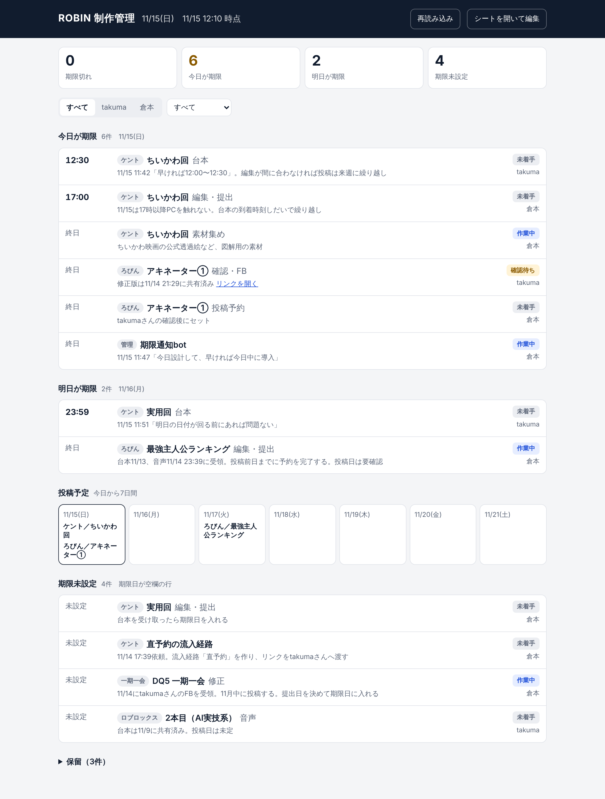

# ROBIN 制作管理

動画制作の期限を1枚のGoogleスプレッドシートで管理し、同じ表から次の2つを動かします。

- 毎朝8時台に、期限切れ・今日が期限・明日が期限のタスクをLINEへ送る
- スマホでも見られる閲覧ページを表示する

## ファイル

| ファイル | 役割 |
|---|---|
| `gas/Code.gs` | シートの読み取り、LINE送信、閲覧ページの配信 |
| `gas/index.html` | 閲覧ページ |
| `test/code.test.js` | 日付の読み取りと通知文のテスト（`node --test test/code.test.js`） |

## シートの形

「タスク」という名前のシートに、1行目を次の列名にして使います。列の順番は変えても動きますが、列名は変えないでください。

`案件` `動画・内容` `作業` `担当` `期限日` `期限時刻` `状態` `投稿予定日` `メモ` `リンク`

- 期限日は `2026/11/16`、期限時刻は `18:00` の形で入れます。
- 状態が「完了」「保留」の行は通知に出ません。
- 期限日が空欄の行は、通知の最後に件数だけ出ます。

## 導入手順

### 1. LINE公式アカウントを作る（約10分）

1. [LINE公式アカウントの作成ページ](https://www.lycbiz.com/jp/service/line-official-account/)からアカウントを1つ作ります。名前は「ROBIN 制作管理」など。
2. [LINE Official Account Manager](https://manager.line.biz/) を開き、右上の「設定」→「Messaging API」→「Messaging APIを利用する」を押します。プロバイダーは新しく作って構いません。
3. [LINE Developersコンソール](https://developers.line.biz/console/) を開き、いま作ったチャネルを選びます。
4. 「Messaging API設定」タブの一番下で「チャネルアクセストークン（長期）」を発行し、控えます。これが `LINE_TOKEN` です。
5. 「チャネル基本設定」タブの一番下にある「あなたのユーザーID」（`U` で始まる文字列）を控えます。これが `LINE_TO` です。
6. 「Messaging API設定」タブのQRコードを自分のLINEで読み取り、botを友だちに追加します。追加していない相手には送れません。

手順の公式説明：[Messaging APIを始めよう](https://developers.line.biz/ja/docs/messaging-api/getting-started/)

### 2. Apps Scriptにコードを貼る（約5分）

1. スプレッドシートを開き、「拡張機能」→「Apps Script」を押します。
2. 最初からある `コード.gs` の中身を全部消し、`gas/Code.gs` の中身を貼り付けます。
3. 左の「ファイル」の＋から「HTML」を選び、名前を `index` にします。中身を全部消して `gas/index.html` を貼り付けます。
4. 左の歯車「プロジェクトの設定」を開き、一番下の「スクリプト プロパティ」に次の2つを追加します。

   | プロパティ | 値 |
   |---|---|
   | `LINE_TOKEN` | 手順1-4で控えたトークン |
   | `LINE_TO` | 手順1-5で控えたユーザーID |

### 3. 送信を試して、毎朝の通知を登録する

1. エディタ上部の関数の選択で `sendMorningDigest` を選び、「実行」を押します。初回は権限の確認画面が出るので許可します。自分のLINEに期限一覧が届けば成功です。
2. 続けて `setup` を選んで「実行」します。これで毎朝8時台に送られます。Apps Scriptの時間指定は前後15分ほどずれます（[公式の説明](https://developers.google.com/apps-script/guides/triggers/installable#time-driven_triggers)）。

登録後は、スプレッドシートのメニュー「制作管理」からも「今すぐLINEに送る」「通知を止める」を選べます。

### 4. 閲覧ページを公開する

1. Apps Scriptの右上「デプロイ」→「新しいデプロイ」→ 種類は「ウェブアプリ」。
2. 「次のユーザーとして実行」は「自分」にします。
3. 「アクセスできるユーザー」を選びます。
   - 「自分のみ」：倉本さんのGoogleアカウントでログインしているときだけ見られます。
   - 「全員」：URLを知っている人は誰でも、ログインなしで見られます。takumaさんにも見せる場合はこちらですが、URLが漏れると案件名とメモが読まれます。
4. 表示されたURLが閲覧ページです。スクリプト プロパティに `PAGE_URL` として入れると、毎朝の通知の末尾にURLが付きます。

`index.html` や `Code.gs` をあとで書き換えたときは、「デプロイを管理」→ 鉛筆 → バージョン「新バージョン」で更新します。

### 5. 送信先をグループにする（任意）

グループに送るには、そのグループのID（`C` で始まる文字列）が必要です。IDはLINEアプリの画面には出ないので、botがグループに入ったときにLINEから届く通知（Webhook）で受け取ります（[グループIDの説明](https://developers.line.biz/ja/docs/messaging-api/group-chats/)）。

1. [LINE Official Account Manager](https://manager.line.biz/) の「設定」→「アカウント設定」で、「グループ・複数人トークへの参加を許可する」を選びます。初期設定は「許可しない」です。
2. 手順4のウェブアプリを、アクセスできるユーザー「全員」でデプロイします。LINEのサーバーはログインできないため、「自分のみ」では通知が届きません。URLは `https://script.google.com/macros/s/…/exec` の形です。
3. [LINE Developersコンソール](https://developers.line.biz/console/) の「Messaging API設定」で、Webhook URLに手順2のURLを入れ、「Webhookの利用」をオンにします。「検証」ボタンはApps Scriptの仕様で302エラーと表示されることがありますが、通知自体は届きます。
4. LINEアプリで、送りたいグループにbotを招待します。招待後、グループで何か1通送ります。
5. Apps Scriptのスクリプト プロパティに `LINE_GROUP_ID` が増えていることを確認します。
6. 関数 `useGroup` を実行します。グループに「このグループに、毎朝の制作期限を送ります。」と届けば切り替え完了です。
7. グループIDは変わらないので、閲覧ページを公開したくない場合は、デプロイのアクセスを「自分のみ」に戻し、Webhookの利用をオフにします。

### 6. 送信先のグループを増やす（任意）

1. Webhookの利用をオンにし、ウェブアプリのアクセスを「全員」にします（手順5で戻していた場合）。
2. 追加したいグループにbotを招待し、そのグループで1通送ります。
3. 関数 `addGroup` を実行します。そのグループに「このグループにも、毎朝の制作期限を送ります。」と届けば追加完了です。

`LINE_TO` にはIDがカンマ区切りで並びます。送信先から外したいときは、その値から該当のIDを消します。

Webhookで届いたIDは `LINE_GROUP_ID` に控えるだけで、送信先（`LINE_TO`）は `useGroup` を手で実行するまで変わりません。

### 7. LINEから操作する（任意）

botが入っているグループで、次のコマンドだけを1通で送ると、botが返事をして処理します。文の途中に含まれているだけでは反応しません。

| コマンド | すること |
|---|---|
| `/rm off` | グループ名に「Robin Marketing」を含むグループへの毎朝の通知を止める |
| `/rm on` | 止めた通知を再開する |
| `/status` | いま通知が届くグループと、止めているグループを表示する |
| `/help` | 使える言葉の一覧を表示する |

受け付けるのは、送信先か一時停止中のグループからの発言だけです。使うには、LINE Developersコンソールの「Webhookの利用」をオンにし、ウェブアプリのアクセスを「全員」にしておく必要があります。コードを貼り替えたときは「デプロイを管理」から新バージョンでデプロイし直してください。

## 変更したいとき

| やりたいこと | 変える場所 |
|---|---|
| 送信時刻を変える | `Code.gs` の `SEND_HOUR` を変えて `setup` を実行し直す |
| 送信先をグループにする | 導入手順の5 |
| 送信先を個人に戻す | `LINE_TO` を自分のユーザーID（`U` で始まる）に書き戻す |
| 通知に出さない状態を増やす | `Code.gs` の `CLOSED_STATUSES` |

## 料金の目安

LINE公式アカウントの無料プランは月200通までです（[料金プラン](https://www.lycbiz.com/jp/service/line-official-account/plan/)）。個人宛に1日1通なら月31通以内です。グループ宛にすると、1回の送信でメンバーの人数分を消費します。
